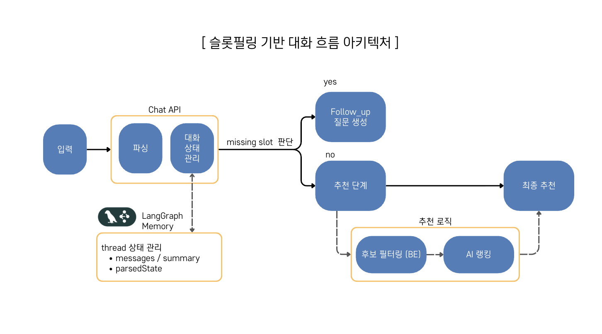
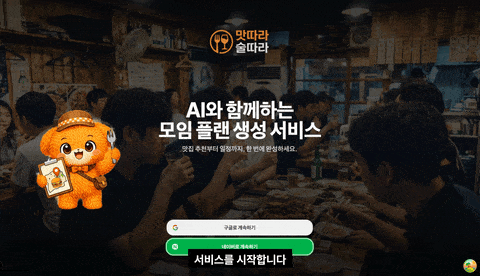
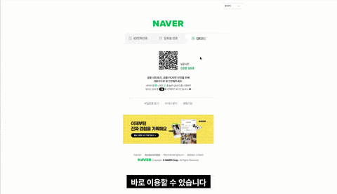
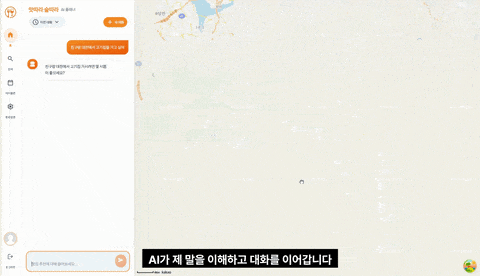
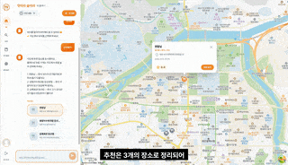
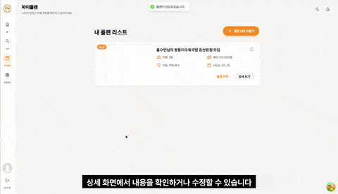

<!-- logo -->

### 맛따라 술따라 - AI 챗봇 프로젝트

 

## 📝 전체 서비스 설명

맛따라 술따라는 약속 장소를 정하는 과정에서 생기는 탐색 피로를 줄이기 위해 만든 **AI 기반 대화형 맛집·장소 추천 서비스**입니다.  

 

## 🏗️ 프로젝트 아키텍처

 

## 🤖 AI 기능 상세

AI 레이어는 **FastAPI**로 노출되고, 대화 흐름은 **LangGraph**(`StateGraph`)로 구성됩니다. 멀티턴 맥락은 **Redis 기반 체크포인터**(`RedisSaver` 등)로 유지하며, 사용자 발화에서 필요한 정보를 모으는 **슬롯필링**과 추천·후속 질문 생성에는 **LangChain / OpenAI API**를 사용합니다.

- **대화 오케스트레이션**: LangGraph 상태·노드로 턴별 처리
- **상태 저장**: 스레드별 체크포인트(Redis / `langgraph-checkpoint-redis`)
- **추천·NLG**: 조건 수집 후 장소 추천 및 응답 생성

### AI 아키텍처

 

### 화면 구성

| 화면 구성 | 화면 구성 |
|:---:|:---:|
| 로그인 (소셜 로그인) | 선호 온보딩 |
|  |  |
| 챗봇 화면 | 장소 추천 · 지도 마커 |
|  |  |
| 홈 · 장소 리뷰 | 맛집 검색 |
| GIF 준비중 | GIF 준비중 |
| 마이플랜 관리·공유 | — |
|  | — |

 

## 🗂️ APIs

작성한 API는 아래에서 확인할 수 있습니다.

👉🏻 [API 바로보기](./backend/APIs.md)

 

## ⚙ 기술 스택

### Frontend

### Backend

### AI

### Infra

### Tools

 

## 👤 맡은 역할

저는 이 프로젝트에서 **AI 챗봇 파트**를 맡아, 슬롯필링 기반 조건 수집·추천 흐름과 **LangGraph** 상태·체크포인터를 활용한 멀티턴 대화를 구현했습니다.

 

## 🤔 기술적 이슈와 해결 과정
- 슬롯 정보가 부족한 사용자 입력 처리
    - 필수 슬롯 우선순위 기반 재질문 전략으로 누락 정보 보완
- 멀티턴 대화에서 문맥 유실 문제
    - LangGraph 상태 노드 분리와 체크포인터로 대화 맥락 유지
- LLM 호출 비용/지연 이슈
    - Rule-based 전처리 + 필요 시 LLM 호출하는 하이브리드 구조 적용

 